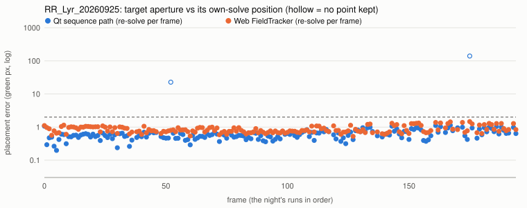
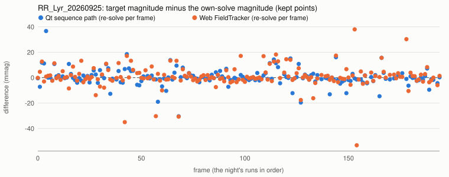
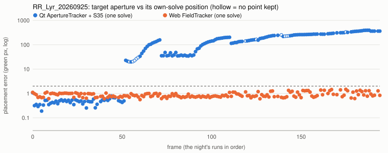
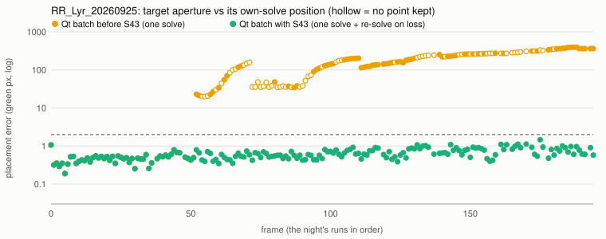
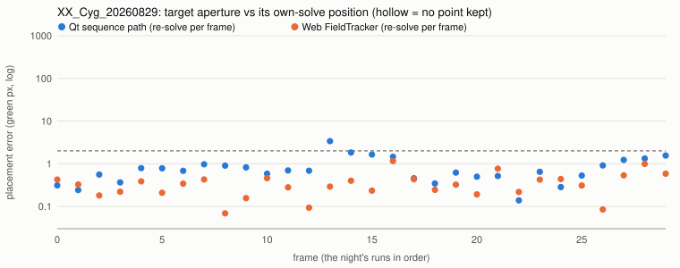
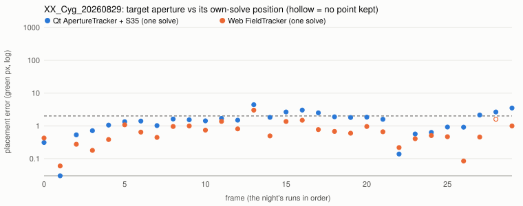
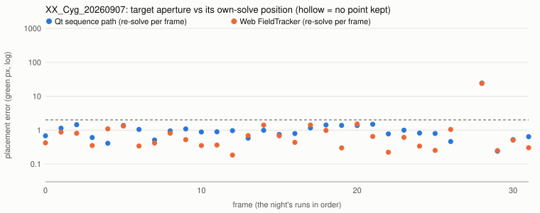
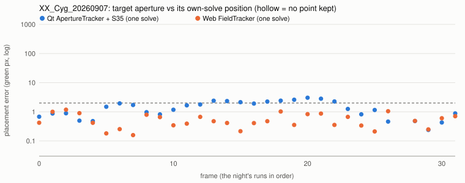

# Aperture tracking: Qt's ApertureTracker + S35 against the web FieldTracker

> Study for owner decision 4 of wave 6 (`web/spec/waves.md` §5 W6): compare the
> trackers on the owner's runs, with figures, **before any change**. Nothing is
> adopted here; the last section lists facts and options.
> Date: 2026-11-12. Code: release/0.5.0 worktree with S43 (Qt), explore/web-ui
> `argos/server/field_track.py` (web). Every number below comes from
> `tracker_comparison/results.json`, `tracker_comparison/details.json` or
> `tracker_comparison/tables.md`, written by the scripts in
> `tracker_comparison/scripts/` (re-run instructions at the end).
> **Revised 2026-11-12 after the wave 6a science review:** the truth now moves
> each star to the frame's date by its proper motion (RR Lyr has moved 0.8 green
> px since the J2000.0 catalogue position, §3). That reverses the RR Lyr target
> comparison of the first version (web 0.24 px, Qt 0.57 px): against the real
> star the web places the target at 0.79 px and Qt at 0.59 px, while on the
> comparison stars (no proper motion) the web stays at 0.26 px and Qt at 0.59 px.
> The XX Cyg numbers did not change.

## 1. Question

During a sequence, Argos places each saved sub's apertures through the latest
plate solution moved by a tracker that follows anchor stars from frame to frame.
Two trackers exist:

- **Qt**: `ApertureTracker` (`argos/core/photometry/tracking.py`) as the sequence
  path drives it (`acquisition_engine.py` `_on_seq_frame_saved` →
  `_measure_photometry`): rebuilt after each solve on the frame being measured,
  anchors = comparisons/checks seen at SNR ≥ 10 (S35: else any star of the set
  seen at SNR ≥ 5); the frame gets no point when no anchor is matched (S35). The
  batch re-run uses the same tracker, built once (and, with S43, re-solves a
  frame on which the lock is lost). Decision 2 makes the web sequence path copy
  this exactly.
- **Web**: `FieldTracker` (`argos/server/field_track.py`), which today places
  overlays only: anchors chosen on the solved frame (detected stars when fewer
  than two comparisons qualify), signal baselines from the solved frame, a
  second centroid pass centred on the first, a pair-distance consistency rule,
  health `ok`/`degraded`/`lost`, and re-acquisition of a lost lock by a
  star-pattern vote (`vote_transform`).

Asked: per frame, where each tracker puts the apertures against an independent
truth; frames kept, flagged, lost; the target's magnitudes and errors and the
differences in mmag.

## 2. Data

Copies (APFS clones, read-only) of the owner's runs; no header field other than
the image, `DATE-OBS`, `EXPTIME` and `EGAIN` is read, and no site is used (no
airmass, no BJD: the magnitudes do not depend on them). For §4.4 only, the
live flight recorder and target CSV of `20260907T045156Z` are read on a copy.

| Night | Runs | Frames | Exposure | Cadence (median) | Field motion |
|---|---|---|---|---|---|
| XX Cyg 2026-08-29 | 3 (22, 4, 4 frames) | 30 | 15 s | 70.7 s | rotation up to 13.3° over a run |
| XX Cyg 2026-09-07 | 4 (24, 2, 3, 3 frames) | 32 | 20-60 s | 74.9-84.9 s | rotation up to 16.0° over a run |
| RR Lyr 2026-09-25 | 1 (`20260925T200453Z`) | 195 | 10 s | 51.5 s | drift ~4.4 px per frame, jumps of 22.8 px (frame 52) and 140.6 px (frame 175) |

The RR Lyr session folder holds 585 FITS files: 195 lights in `lights/` and 390
Siril products in `process/`; the study uses the 195 lights. The two
single-frame XX Cyg sessions of 2026-08-29 have no target set and are left out.
Rotation figures are the batch tracker's final transform (`results.json`,
`runs.*.arms.batch_s43.summary`); cadence from the frames' `DATE-OBS`.

**Check star.** The runs have none; on the copies the comparison nearest the
target on the sky becomes the check (`common.load_target_set`), so every
ensemble has one comparison fewer than the owner's.

## 3. Method

**Truth.** Each frame is plate-solved on its own with ASTAP (CLI 2026.05.18,
D05 database) at downsample 2, 1 and 3; the frame's truth is a solution that a
second downsample reproduces within 1 green px at every corner and the centre
(`solve_frames.py --mode truth`). 245 of 257 frames have one; 11 RR Lyr frames
(37, 47, 118, 136, 138, 160, 164, 169, 171, 177, 192) and XX Cyg
`20260907T045156Z` frame 1 do not and are left out of every error statistic.
Accuracy of the truth: a second, independent solve with Argos's own live
settings lands 0.02-0.08 px (median, per run) from it at the target, 0.94 px
at the 95th percentile on RR Lyr (`tables.md`, per-run "Solves" lines).
Differences between trackers smaller than about 0.1 px median are therefore
not resolved.

**Proper motion.** The target sets hold J2000.0 catalogue positions (VSX, VSP),
and neither app applies proper motion. The truth moves a star to the frame's
exposure midpoint by its proper motion when `proper_motions.json` gives one:
RR Lyr only (Gaia EDR3 via SIMBAD, −109.6 and −195.8 mas/yr, quoted by the
science review and not re-fetched: SIMBAD is unreachable from this network; a
5 mas/yr error would move the truth by 0.02 px). `truth_check.py` checks the
result on the image, against each star's centroid within 6 px
(`truth_check.json`): RR Lyr's catalogue position is 0.96 px (median, 184
frames) from the star and the moved one 0.20 px; the comparison stars, not
moved, are 0.33 px from theirs (RR Lyr) and 0.13-0.29 px (XX Cyg); the XX Cyg
target, not moved, 0.24-0.39 px. The first version of this study used the
catalogue position for every star.

**Arms** (all on the same frames, the same target set, one aperture for the
whole run (radius 5.3-7.4 px, 2.5 × the series FWHM measured on the first
frame, as the batch does), each
frame's own `EGAIN`, and core's unchanged `measure_frame`, so only the
placement differs):

| Arm | What runs |
|---|---|
| Qt sequence path | a real `AcquisitionEngine` (offscreen, no device) fed each frame through `_on_seq_frame_image` / `_on_seq_frame_saved`, its `measure_frame` results captured unchanged (`replay.py`) |
| Web FieldTracker | the real `FieldTracker` and `vote_transform`, driven as `FieldService._track` / `_build_tracker` / `_reacquire` drive them (re-implemented around the classes in `replay.py`, not the running server); the point is skipped when health is `lost` (the S35 rule) |
| Qt batch before S43 / with S43 | the real `PhotometryBatchWorker` of each tree, reference = the first frame's truth, S43 re-solve through the page's `batch_frame_solver` with ASTAP (`run_batch.py`) |

**Solve schedules.** *Re-solve per frame*: the auto-solve re-solves when 20 s
have passed since the last solve (`astrometry.live_resolve_s`); with cadences
of 50-85 s that is every frame, and the solution (0.09 s median, 2.07 s at most
with Argos's settings) lands before the next frame, so each frame is measured
through the previous frame's solution. The live arms get what Argos's live
settings return for each frame (`solve_frames.py --mode argos`), wrong
solutions included. *One solve*: the frame-0 truth only, for the whole run (a
run whose later solves all fail): the tracker alone carries the run.

**Measures.** Placement error = distance between the aperture centre an arm used
and the truth position (green px; for RR Lyr the star's position on the frame's
date, so the 0.8 px of proper motion that neither app applies is part of every
arm's target error). *Off-star point*: a written, unflagged
target point more than 2 px from the truth (apertures are 5.3-7.4 px). dmag =
arm magnitude − truth magnitude on the same frame; dinst = the same for the
target's instrumental magnitude (placement alone, without the ensemble).

## 4. Results

### 4.1 Headline (per night; target star; full tables in `tables.md`)

| Night | Arm | kept / lost | placement median / p95 px | off-star points | dmag rms mmag | dinst rms mmag |
|---|---|---|---|---|---|---|
| RR Lyr | Qt sequence path | 193 / 2 | 0.59 / 0.99 | 0 | 6.6 | 3.8 |
| RR Lyr | Web, re-solve per frame | 195 / 0 | 0.79 / 1.28 | 0 | 8.9 | 4.4 |
| RR Lyr | Qt tracker + S35, one solve | 126 / 69 | 117.6 / 362.9 | 67 | 1404 | 4637 |
| RR Lyr | Web, one solve | 195 / 0 | 0.81 / 1.31 | 0 | 7.6 | 4.8 |
| RR Lyr | Qt batch before S43 | 133 / 62 | 117.6 / 362.9 | 74 | 1426 | 4730 |
| RR Lyr | Qt batch with S43 | 195 / 0 | 0.58 / 1.00 | 0 | 10.3 | 4.3 |
| XX Cyg 08-29 | Qt sequence path | 30 / 0 | 0.68 / 1.74 | 1 | 359 | 152 |
| XX Cyg 08-29 | Web, re-solve per frame | 30 / 0 | 0.33 / 0.89 | 0 | 258 | 57 |
| XX Cyg 08-29 | Qt tracker + S35, one solve (= batch, before and with S43) | 30 / 0 | 1.51 / 3.29 | 7 | 387 | 192 |
| XX Cyg 08-29 | Web, one solve | 29 / 1 | 0.65 / 1.55 | 1 | 324 | 241 |
| XX Cyg 09-07 | Qt sequence path | 31 / 1 | 0.89 / 1.47 | 0 | 178 | 186 |
| XX Cyg 09-07 | Web, re-solve per frame | 32 / 0 | 0.52 / 1.47 | 1 | 219 | 356 |
| XX Cyg 09-07 | Qt tracker + S35, one solve | 32 / 0 | 1.25 / 2.70 | 9 | 241 | 240 |
| XX Cyg 09-07 | Web, one solve | 32 / 0 | 0.48 / 1.04 | 0 | 172 | 156 |
| XX Cyg 09-07 | Qt batch (before and with S43) | 32 / 0 | 1.29 / 2.42 | 8 | 178 | 175 |

On the RR Lyr comparison stars (median placement, all comparisons, `results.json`
`comparisons_err_median`): Qt sequence path 0.59 px, web 0.26 px; one solve,
Qt 81 px (the lost field), web 0.32 px. Qt's apertures sit 0.50 px off in y on
every star (median offset vector of the comparisons (+0.03, +0.50) px, web
(+0.04, +0.09)); on RR Lyr that bias happens to point against the star's
proper-motion offset (catalogue minus star: (−0.44, −0.69) px), which is why
Qt's target error (0.59 px) is below the web's (0.79 px), whose apertures sit
on the catalogue position (median vector (−0.41, −0.58) px). Neither tracker
places the target better on purpose.

No arm flagged a target point (the S43 batch flags only frames it could not
re-anchor; it re-anchored all). Truth photometry, for scale: RR Lyr target
median formal error 11.8 mmag; XX Cyg 215.5 mmag (08-29) and 163.4 mmag (09-07).

### 4.2 RR Lyr 2026-09-25 (195 frames)






(Dashed line: the 2 px off-star limit. Hollow marker: no point kept.)

- **Steady frames.** With a solve per frame the target stays within 1.3 px
  of the star on every kept frame: Qt 0.59 px median, web 0.79 px, both
  including the 0.8 px of proper motion neither app applies (§4.1). On the
  comparison stars, which show the tracker alone, Qt's error grows with the
  frame-to-frame motion (least-squares slope 0.131 px per px of motion; median
  0.47 px for motions under 4 px, 0.63 px above, 850 star-frames), the web's
  does not (slope 0.077; 0.48 px and 0.24 px; on the 41 frames that moved less
  than 4 px the web is not better) (`details.json`, `lag_comparisons`). That
  is consistent with the lag of a centroid window centred on the prediction,
  which the web's second pass removes; the study does not isolate that cause.
- **Photometric effect on steady frames.** Against the truth magnitude, Qt's
  sequence path differs by 6.6 mmag rms and the web's by 8.9 mmag; for the
  instrumental magnitude alone 3.8 and 4.4 mmag; the check star 7.3 and 8.2
  mmag. All are below the target's own 11.8 mmag formal error: on this run
  neither tracker's placement noise matters against photon noise. The full
  magnitude differs more than the instrumental one, so most of its difference
  comes from the comparisons (placed by the same tracker).
- **The two jumps (frames 52 and 175).** Sequence path: each jump frame is
  measured through the previous frame's solution; Qt rebuilds its tracker on
  the jumped frame, finds no anchor and skips the frame (S35): **no point on
  frames 52 and 175**, nothing measured off the star. The web tracker's windows
  also matched no anchor on either frame (0 of 6, 0 of 5), but its vote found
  the field (120 and 103 matched stars; `probe_reacquire.py`) and it measured
  both frames 0.80 px and 1.46 px from the star.
- **One solve for the whole run.** Qt's tracker loses the field at frame 52
  (23.1 px off, one noise-locked anchor, so S35 does not skip it) and never
  finds it again: 126 points kept, 67 of them off the star (up to 395 px; none
  of the 66 kept frames after 52 that have a truth is within 2 px,
  `details.json`, `solo_qt_after_jump`), 69 frames without a point. This is
  the batch failure that S43 fixes, and the batch before S43 shows it on the
  same frames (74 off-star points). The web tracker keeps all 195 frames
  within 1.5 px of the star.
- **Batch with S43.** Two re-solves (frames 52 and 175); all 195 target points
  on the star (0.58 px median, 1.46 px at most); no frame flagged.

### 4.3 XX Cyg, 2026-08-29 and 2026-09-07 (62 frames)






- **Rotation.** These runs rotate by up to 16° in 24 frames (about 0.7° per
  frame). With one solve, Qt's tracker trails
  the rotation: 1.25-1.51 px median, 16 target points more than 2 px off (up to
  4.4 px, with 5.5 px apertures) on the two nights; the web tracker 0.48-0.65 px
  and 1 such point. With a solve per frame Qt is at 0.68-0.89 px (1 point over
  2 px, 3.4 px), the web at 0.33-0.52 px (1 point over 2 px: the wrong-solution
  frame of §4.4). The S43 batch is unchanged here: it lost no
  frame and re-solved none (all 7 runs).
- **Magnitudes.** These runs are photon-noise dominated (target formal errors
  81-231 mmag per run, comparisons down to V 14.15): a sub-pixel shift can drop
  or restore a comparison in the ensemble clip, which moves the target by about
  0.2 mag (frame 0 of `20260829T050148Z`: moving every aperture 0.3 px left
  clips one comparison and moves the target 220 mmag,
  `ensemble_sensitivity.py`). The dmag columns of XX Cyg therefore say nothing
  about the trackers and are not interpreted.

### 4.4 A wrong plate solution (XX Cyg `20260907T045156Z`, frame 1)

Argos's live settings (downsample 2, scale hint, 30° radius) solved this frame
at 7.093″ per green px, 3.4 % below the run's median; every other one of the
257 frames solved at 7.329-7.348″ (`tables.md`, "Solves"). The frame has no
consensus truth (§3): its solves at other downsamples do not agree with this
one. Frame 2 is then measured through that solution (`details.json`,
`wrong_solve`):

- **Qt sequence path**: one window locked on noise (1 anchor), so S35 does not
  skip; apertures 21-24 px off every star; the target gets no magnitude (SNR
  0.0) but the check star (10.404, truth 10.335, SNR 3.9 instead of 59.2) and
  three comparisons are written unflagged.
- **Web FieldTracker**: its anchors are stars detected on the solved frame, so
  it follows the real stars and reports `ok` (6 anchors), but the catalogue
  positions come from the wrong solution: the target is written at 11.020
  (truth 11.952, SNR 2.6), 23.9 px off the star.
- **The owner's own file** (the live run of that night, read on a copy): its
  flight recorder shows frame 2's target aperture at SNR 0.91, 26.1 px from
  the frame's truth position, and the run's target CSV has its third row at
  13.104 ± 1.204 against 12.003 and 11.983 before it (`details.json`,
  `owner_live`): the same failure, in a file the owner holds, written unflagged.

Neither S35's rule (no anchor matched) nor the web's health catches a wrong
solution; the S43 lock check (half of the anchors showing a star at SNR ≥ 5
where the tracked solution places them) would: the check star and the
comparisons show SNR 0-4.6 where the Qt path placed them.

## 5. The Qt live sequence path and S43's failure (decision 2)

On RR Lyr, frames 0-79 through frame 0's solve with the owner's set, the
batch before S43 wrote 9 unflagged target points 21.4-127.0 px off the star
(5.58-10.51 mag; the star is at 7.43-7.55) and left 19 frames without a point
from frame 52 on, and called the run tracked; with S43 all 28 frames are
measured 0.3-0.8 px from the star (`details.json`, `first80`; release note
S43). The live sequence path does not fail that way on these frames: because
it re-solves every frame (cadence ≥ 50 s against `live_resolve_s` = 20 s), its
tracker is rebuilt on each frame and S35 skips the two jump frames (193 kept,
2 lost, 0 off-star, 0.59 px median). It fails the batch's way only when its
solves stop: with one solve, 67 off-star points and 69 lost frames on the same
run (§4.2). And it measures through a wrong solution (§4.4).

## 6. Limits

- One telescope (alt-az Seestar, IMX585, 7.34″ per green px); no equatorial run.
- 257 frames, of which 195 from one RR Lyr run; 2 real jumps. The XX Cyg runs
  are short and too noisy for photometric conclusions (§4.3).
- Truth = one ASTAP version and database; a TAN solution without distortion
  terms; 12 frames without a consensus truth are left out; solver noise up to
  0.94 px (95th percentile) on RR Lyr.
- Catalogue epoch and proper motion: the target sets are J2000.0 positions.
  The truth applies a proper motion to RR Lyr only (§3); the comparison stars
  and XX Cyg are not moved (their centroids sit 0.13-0.39 px from the truth,
  median per run, `truth_check.json`). Neither app applies proper motion, so a
  high proper-motion target sits off its aperture in both: RR Lyr by 0.8 px, a
  few nearby flare stars by more than 10 px. `TargetStar` has no
  proper-motion field.
- The solve schedule is simulated from frame times: the 2 arcmin mount-motion
  trigger is not replayed (no mount positions), solves are hinted at the target,
  not at the mount, and are assumed to land before the next frame (true for
  every solve here: 2.07 s at most against ≥ 50 s cadences).
- The web arm re-implements `FieldService`'s tracking around the real classes;
  the running server was not used. In the web app the sequence apertures are
  placed by core's tracker (decision 2): the web arm shows what FieldTracker
  would do if it placed them.
- All arms share one aperture (the series FWHM of the first frame) and the
  frame's `EGAIN`; the live engine would use the live FWHM. A check star was
  assigned on the copies.
- The lag attribution (§4.2) is a correlation, not an isolated test.

## 7. Facts and options for the owner

Facts:

1. With a solve on every frame (the sequence case at these cadences), both
   trackers keep the target within 1.5 px of the star on every kept RR Lyr
   frame (Qt 0.59 px median, web 0.79 px, both carrying the 0.8 px of proper
   motion neither app applies; on the comparison stars web 0.26 px, Qt
   0.59 px) and within 0.33-0.89 px median on the rotating XX Cyg runs (one Qt
   point at 3.4 px); the placement's effect on the RR Lyr magnitudes is a few
   mmag either way, below its 11.8 mmag noise.
2. On a pointing jump larger than the 15 px search radius, Qt's sequence path
   skips the frame (2 of 195 on RR Lyr); the web tracker recovers it by its
   star-pattern vote.
3. Without new solves, Qt's tracker loses a jumped field for good and S35
   catches only the frames with no anchor at all (67 off-star points on RR
   Lyr); the web tracker kept all 195 frames.
4. Neither tracker detects a wrong plate solution; the S43 lock check does. One
   such solution was found in 257 frames, 3.4 % off in scale where every other
   solve is within 0.25 % of its run's median; the owner's 2026-09-07 XX Cyg
   target CSV holds an unflagged row measured the same way (SNR 0.91, 26 px
   from the star).
5. S43 makes the batch correct on these runs: 0 off-star points, 0 flagged,
   2 re-solves on RR Lyr, no change on the XX Cyg runs.

Options (none adopted; decisions for the owner):

- **A. Keep decision 2 as it stands.** Web and Qt sequence paths identical; jump
  frames lose their point; wrong solutions and noise locks stay possible
  (facts 2-4).
- **B. Add S43's lock check to the live path** (Qt as the next free S number,
  S48; the web for parity):
  a frame where fewer than half the anchors show a star where the solution puts
  them gets no point. On these runs the check never failed a good frame (S43
  batch: 0 flagged in 257 frames) and would have skipped the §4.4 frame.
- **C. Gate every solve on its plate scale** (auto-solve, Open FITS, S43
  re-solve): reject a solution more than 1 % from the expected scale
  (`arcsec_per_green_px()`, 7.477″, or the previous solution); good solves
  here span 7.329-7.348″, the wrong one 7.093″. Note the profile value is 1.8 %
  above every measured solve: a 1 % gate needs the measured scale (first good
  solve) as its reference.
- **D. Let FieldTracker place the photometry apertures too** (both apps): keeps
  jump frames and long unsolved stretches, 0.3 px tighter on the comparison
  stars; values change by a few mmag; it still needs B or C, since its health
  stays `ok` on a wrong solution, and like Qt it places a target at its
  catalogue position (a proper-motion field in `TargetStar` would be a
  separate change).
- **E. Port only the second centroid pass into `ApertureTracker`**: the smallest
  change aimed at the lag (comparison stars: slope 0.131 against 0.077); it
  does not recover jumps.

B and C are independent of the tracker choice; D and E are alternatives.

## 8. Reproduce

`run_all.sh` also writes `truth_check.json` (`truth_check.py`).
`TRACKER_STUDY_PM=none` in the environment turns the proper motion off and
reproduces the first version's truth.

On copies of the session folders (`<copies>/<run>/lights`, `targets.json`; for
§4.4 also `diagnostics/` and `photometry/` of `20260907T045156Z_XX_Cyg`):

```sh
QT_QPA_PLATFORM=offscreen notes/tracker_comparison/scripts/run_all.sh \
  <copies> <work dir> <release-0.5.0 worktree> <tree before S43> \
  argos/server/field_track.py <astap_cli> <python> notes/tracker_comparison
PYTHONPATH=<release-0.5.0 worktree> python notes/tracker_comparison/scripts/details.py \
  <work dir> notes/tracker_comparison/details.json <copies>
PYTHONPATH=<release-0.5.0 worktree> python notes/tracker_comparison/scripts/probe_reacquire.py \
  <copies>/20260925T200453Z_RR_Lyr/lights <copies>/20260925T200453Z_RR_Lyr/targets.json \
  <work dir>/solves/20260925T200453Z_RR_Lyr.jsonl argos/server/field_track.py 52 175
PYTHONPATH=<release-0.5.0 worktree> python notes/tracker_comparison/scripts/ensemble_sensitivity.py \
  <copies>/20260829T050148Z_XX_Cyg/lights <copies>/20260829T050148Z_XX_Cyg/targets.json \
  <work dir>/solves/20260829T050148Z_XX_Cyg.jsonl
```

`solve_frames.py` (truth and Argos-settings solves), `replay.py` (Qt sequence
path, web tracker, truth photometry), `run_batch.py` (batch before / with
S43, and the frames 0-79 evidence), `analyze.py` (tables, `results.json`,
figures), `details.py` (§4.2 lag and jumps, §4.4, §5, solve times),
`probe_reacquire.py` (§4.2, how the web held the jumps),
`ensemble_sensitivity.py` (§4.3), `common.py` (shared helpers). The full run takes
about 25 minutes on the owner's laptop, most of it the replays.
